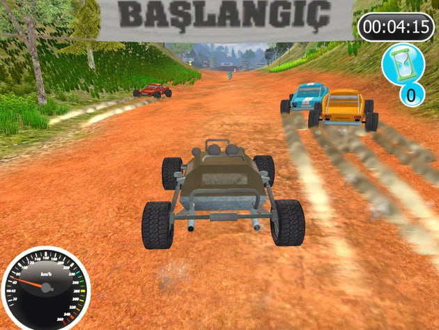
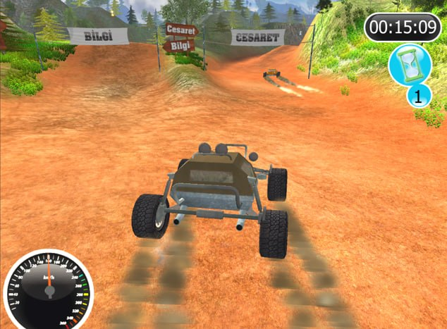

# Yarışçı Arazi (2009)

TRT Çocuk için 2009'da yapılmış yarış oyunu. Orijinal proje Unity 2.6.1f3 ile derlenmişti; decompile edilip kaynak kodu kurtarıldı, ardından tarayıcıda çalışacak sürümü üretildi.





## Tarayıcı sürümü

Oyun artık kurulum istemiyor. Unity 2022.3 WebGL build'i `port/yarisciarazi/Builds/WebGL` altında.

Build Brotli sıkıştırmalı olduğu için sunucunun `Content-Encoding: br` ve `.wasm` için `application/wasm` başlığını göndermesi gerekiyor. Düz `python -m http.server` bu build'i açmaz.

## Düzeltilenler

1. **Araç seçim ekranında Enter tuşu.** Oyun yüksek FPS'te çalıştığı için `FixedUpdate` arasına sıkışan tuş girdileri kayboluyordu. Dinleyiciler `Update`'e taşındı, tek basışta araç seçiliyor.
2. **Araç menüsü animasyonu.** Aynı FPS sorunu yüzünden araçlar saniyede yüzlerce tur atıyordu. Animasyonlar FPS'ten bağımsız hale getirildi.
3. **Soru ekranı bekleme süresi.** Doğru cevaptan sonraki 3,5 saniyelik bekleme 1 saniyeye indirildi.
4. **Sunucu istekleri.** Oyun açılışta kullanıcı adı/şifre gönderiyor, yarış sonunda skoru TRT'nin artık yanıt vermeyen sunucusuna yolluyordu. İstekler kapatıldı.

## Derleme

Unity 2022.3.62f3, WebGL modülü açık. Komut satırından:

```
Unity.exe -batchmode -quit -nographics -projectPath D:/999/port/yarisciarazi \
  -buildTarget WebGL -executeMethod BuildScript.WebGL -logFile build.log
```

## Credits

Port: [c1tymorgu3](https://github.com/c1tymorgu3)
Orijinal oyun: TRT Çocuk, 2009
